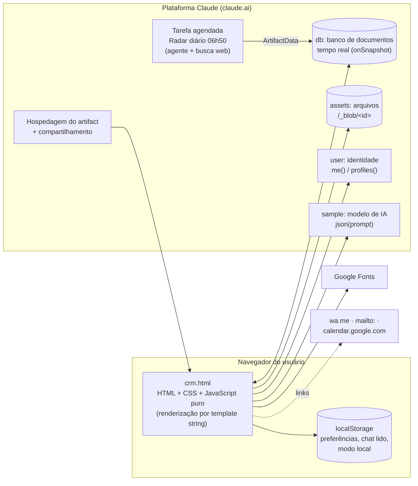
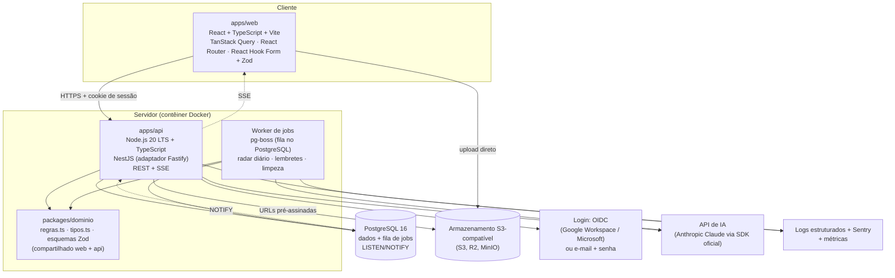

# Arquitetura técnica · atual e proposta independente

Legenda: **[V]** verificado no código ou no ambiente, **[I]** inferido, **[C]** a confirmar.

---

## 1. Arquitetura atual (protótipo)

### 1.1 Visão geral



### 1.2 Tecnologias [V]

| Item | Hoje |
|---|---|
| Linguagem | JavaScript (ES2020+), sem TypeScript |
| Framework | **Nenhum.** Cada tela é uma função `vNome()` que devolve HTML em template string; `refresh()` redesenha `#main` por `innerHTML` |
| Estilos | CSS próprio no `<style>` (≈ 465 linhas) + 4 blocos injetados por JS; tokens em variáveis CSS; tema claro e escuro por `prefers-color-scheme` |
| Fontes | Google Fonts: Sora (títulos), Figtree (texto), JetBrains Mono (números) |
| Bibliotecas JS | **Nenhuma.** Sem npm, sem build, sem bundler |
| Ícones | SVG inline (objeto `IC`) |
| Persistência | API `db` da plataforma (coleção/documento, `set`, `delete`, `onSnapshot`, `where`) ou `localStorage` (modo local) |
| Arquivos | API `assets` da plataforma (`upload`, `delete`; leitura por `/_blob/<id>`) |
| Identidade | API `user` (`me()`, `profiles(ids)`) |
| IA | API `sample` (`json(prompt, {signal, cache, onText})`, com streaming) |
| Automação | Tarefa agendada na conta do Claude (fora do arquivo) |
| Testes automatizados | **Nenhum** no projeto |
| Controle de versão | **Nenhum** repositório; o histórico de versões é o da plataforma (versão 45 em 21/10/2026) |

### 1.3 Estrutura do código [V]

- **Um único arquivo:** `crm.html`, com 533.769 bytes e 3.483 linhas.
  - CSS: linhas 5 a 470.
  - Marcação: 472 a 491 (barra lateral, `#main`, modal, toast, apresentação, inputs de arquivo ocultos).
  - JavaScript num IIFE: 493 a 3483.
- **Organização por camadas acrescentadas ao longo do tempo:** a primeira metade (até ≈ linha 2266) é a versão original. Depois vêm módulos que **redefinem** funções anteriores. Em JavaScript, a última declaração `function x(){}` vence, então **38 funções** têm duas versões (por exemplo, `refresh`, `renderNav`, `vPainel`, `taskForm`, `clientForm`, `health`, `setStage`). Os módulos, na ordem:
  1. Base original (≈ 493 a 2266).
  2. "v33 · estrutura unificada" (2267): tarefas como unidade única, Produção, Comercial, Clientes, Painel, Equipe novos.
  3. Convite para devolutiva por vídeo (3018).
  4. "+ Follow-up" com convite (3107).
  5. Estratégia e relacionamento (3142).
  6. Radar de oportunidades e novos segmentos (3310).
  7. Recomendações 45 dias (3414).
  8. "Criar tarefa" a partir do radar (3457).
- **Estado global:**
  - `S`: todas as coleções em memória.
  - `ui`: filtros, abas e telas.
  - `me`: conta atual.
  - `mode`: `wait`, `db` ou `local`.
- **Eventos:** delegação global no `document` por `data-act` (click), `data-filter` (change e input), `data-act-blur` (focusout) e outros atributos. Há **vários** `addEventListener('click')`, um por módulo, cada um com seu `switch`.
- **Formulários:** um gerador genérico (`formModal`, `fld`, `readForm`) que recebe a lista de campos `{k, l, t, o, req, …}`.
- **Funções:** 247 funções distintas e 285 declarações.

### 1.4 Dependências da plataforma Claude [V]

| Dependência | Uso | O que substitui na versão própria |
|---|---|---|
| `window.claude.use('db')` | todo o armazenamento e a sincronização | API REST + PostgreSQL + eventos em tempo real |
| `window.claude.use('assets')` | fotos, logos e criativos (até 20 MB; png, jpg, gif, webp, svg, mp4, webm, pdf) | armazenamento de objetos compatível com S3 |
| `window.claude.use('user')` | login, nome, e-mail, avatar, dono e editor | autenticação própria (OIDC ou senha) + papéis |
| `window.claude.use('sample')` | sugestões de conteúdo com IA | API de IA chamada **pelo servidor** |
| Regras de acesso do banco | 4 regras (process, services, objectives, updates) | autorização no back-end (todas as regras) |
| Compartilhamento do artifact | quem entra e quem é Editor (= admin) | cadastro de usuários e papéis no próprio sistema |
| Tarefa agendada no Claude | Radar diário | job agendado no back-end |
| `meta name="claude:viewport-fit-sides"` | ajuste de layout no app do Claude | remover |

**Variáveis de ambiente, chaves e segredos:** **não há nenhum** no código [V]. Toda a autenticação é implícita na plataforma. A versão própria vai precisar deles (ver §6.7).

### 1.5 Integrações externas [V]

| Integração | Como | Observação |
|---|---|---|
| WhatsApp | link `https://wa.me/55<número>?text=<mensagem>` | sem API; quem envia é a pessoa |
| E-mail | link `mailto:` com assunto e corpo | sem servidor de e-mail |
| Google Agenda | link `calendar.google.com/calendar/render?action=TEMPLATE…` (evento de 30 min) | sem API; o cliente salva na agenda dele |
| Cal.com / página de agendamento Google | só o link público, guardado no perfil | não lê horários marcados |
| Google Drive, Dropbox, Canva, Figma | links guardados (pasta do cliente, envio, criativos) | sem API |
| Helpdesk | número ou link do chamado | sem API |
| Google Fonts | CSS de fontes | pode ser auto-hospedado |

### 1.6 Limitações, problemas técnicos e riscos

| # | Tipo | Descrição | Impacto |
|---|---|---|---|
| L1 | Segurança | Quase todas as permissões existem **só na interface** (ex.: "só admin edita dados do cliente"). Qualquer usuário com acesso de uso poderia gravar direto no banco | Alto |
| L2 | Dados | Gravação substitui o documento inteiro, sem controle de concorrência: duas pessoas editando o mesmo cliente → a última vence | Médio |
| L3 | Dados | Sem integridade referencial: excluir cliente ou integrante deixa registros órfãos | Médio |
| L4 | Desempenho | O navegador baixa **todas** as coleções e recalcula tudo a cada tela; `refresh()` refaz o HTML inteiro, além do redesenho periódico a cada 60 s | Alto ao crescer |
| L5 | Manutenção | 38 funções sobrescritas, vários `switch` de eventos, HTML em strings: difícil achar a versão vigente de cada regra | Alto |
| L6 | Tempo | "Hoje" e prazos usam o relógio e o fuso do computador de quem usa; reuniões gravadas sem fuso | Médio |
| L7 | Dados | **Modo local:** fora do Claude, o CRM grava só no navegador, sem avisar a equipe, além do selo "Modo local" | Médio |
| L8 | Qualidade | Sem testes automatizados, sem lint, sem tipos | Alto |
| L9 | Operação | Sem backup sob controle da agência, sem logs de servidor, sem monitoramento | Alto |
| L10 | Dependência | Banco, login, arquivos, IA e radar presos à conta e aos limites da plataforma | Alto |
| L11 | Funcional | Anos do calendário fixos (2026 a 2028) | Médio, a partir de 2028 |
| L12 | Privacidade | Dados pessoais de contatos (aniversário, família, momento de vida) sem política de retenção definida | Médio (LGPD) |
| L13 | Segurança | HTML montado por string. O código usa `esc()` em quase todos os pontos [V], mas qualquer esquecimento vira XSS. Um framework com escape automático reduz o risco | Médio |
| L14 | Arquitetura | Regras e automações (follow-ups automáticos, kickoff, avisos) rodam **no navegador** de quem faz a ação; se a gravação falhar no meio, ficam incompletas (sem transação) | Médio |

**Oportunidades de melhoria:**
- Mover regras para o servidor com transações.
- Paginar e filtrar no banco.
- Notificações reais por e-mail ou push.
- Integrar resultados das redes (Meta e Google Ads).
- Relatório mensal em PDF para o cliente.
- Integração com agenda (Google e Microsoft).

---

## 2. Requisitos que orientam a arquitetura proposta

Vêm do que o protótipo já faz e do pedido da empresa:

1. **TypeScript** no front-end e no back-end, e **MySQL ou PostgreSQL**. Pedido da empresa.
2. **Equipe pequena** (10 integrantes cadastrados [V]) e volume baixo hoje, com crescimento de carteira esperado [I]. Não precisa de microsserviços.
3. **Muita interação em formulários e modais**, filtros instantâneos e listas atualizadas ao vivo (chat, tarefas, radar).
4. **Regras de negócio claras e testáveis** (saúde, capacidade, cadência, prazos), que precisam rodar **no servidor** para serem confiáveis.
5. **Tarefas agendadas** (radar diário; lembretes no futuro).
6. **Arquivos** de até 20 MB (imagens, vídeos, PDF).
7. **IA opcional**, chamada pelo servidor, com chave protegida.
8. **Hospedagem e manutenção pela própria empresa**, com backups, logs e controle de acesso.

---

## 3. Arquitetura proposta



### 3.1 Estrutura do repositório (monorepo)

```text
crm-terceiro-andar/
├── apps/
│   ├── web/                 # front-end React
│   │   └── src/{rotas, telas, componentes, formularios, api}
│   └── api/                 # back-end NestJS
│       └── src/{auth, membros, clientes, comercial, producao, relacionamento,
│                estrategia, planejamento, radar, criativos, agenda, chat,
│                arquivos, ia, auditoria, jobs}
├── packages/
│   ├── dominio/             # regras.ts, tipos.ts (já entregues em proposta/dominio)
│   └── esquemas/            # validação Zod compartilhada (formularios ⇄ API)
├── db/
│   ├── migrations/          # a partir de proposta/schema.sql
│   └── seed/                # proposta/seed_catalogos.sql
├── scripts/migracao/        # importação do export do protótipo
├── docker-compose.yml       # postgres + minio + api + web (desenvolvimento)
└── .github/workflows/       # lint, testes, build, deploy
```

---

## 4. Justificativa das escolhas

| Decisão | Escolha | Por quê, a partir do protótipo | Alternativa aceitável |
|---|---|---|---|
| Banco | **PostgreSQL 16** | O modelo atual usa muitas listas (segmentos, tags, canais, formatos, participantes), regras de unicidade parcial (1 tarefa em execução por pessoa; 1 follow automático por origem), JSON para as ideias da IA e busca por trecho de texto (nome, CNPJ, contato). O PostgreSQL faz tudo isso nativamente (`TEXT[]`, índices parciais, `JSONB`, `pg_trgm`), e o `LISTEN/NOTIFY` dá base para o tempo real sem outro serviço | MySQL 8: funciona com os ajustes de MODELO_DE_DADOS §2.5 (colunas geradas, JSON, FULLTEXT) |
| Linguagem | **TypeScript** nos dois lados | Pedido da empresa. Permite **reaproveitar as regras** (`packages/dominio`) no servidor (fonte da verdade) e na tela (pré-visualização instantânea, como hoje) | — |
| Front-end | **React 18 + Vite** (SPA) | O protótipo já é uma aplicação de página única com modais, abas e filtros sem recarregar; é ferramenta interna, logada, sem necessidade de SEO, então renderização no servidor não traz ganho. React tem a maior base de desenvolvedores, e o escape automático de JSX resolve o risco L13 | Vue 3 + Vite, se a equipe da empresa já usar |
| Dados no front | **TanStack Query** | Substitui o "baixar tudo e assinar" por consultas paginadas com cache e revalidação; invalidação por evento SSE mantém a sensação de tempo real | SWR |
| Formulários | **React Hook Form + Zod** | O protótipo tem cerca de 30 formulários gerados por configuração; Zod permite **o mesmo esquema** validar na tela e na API | Formik + Yup |
| Back-end | **NestJS** (com adaptador Fastify) | Há 12 domínios bem separados, muitas regras de permissão por papel e jobs agendados: os módulos, guards e o agendador do NestJS organizam isso de forma padronizada para um time que vai manter | Fastify puro + Zod, se o time preferir algo mais enxuto |
| Acesso ao banco | **Drizzle ORM** (ou Kysely) | Trabalha "SQL primeiro" (o `schema.sql` entregue vira a migração inicial), suporta índices parciais e arrays do PostgreSQL e é totalmente tipado | Prisma (exige SQL manual para índices parciais e arrays) |
| Tempo real | **SSE** + `LISTEN/NOTIFY` | O protótipo atualiza listas e chat ao vivo. SSE é unidirecional, simples e passa por proxies; o chat envia por POST normal | Socket.IO, se surgir edição colaborativa |
| Jobs | **pg-boss** | Usa o próprio PostgreSQL como fila, sem Redis; cobre o radar diário às 06h50, lembretes e limpeza | BullMQ + Redis |
| Arquivos | **S3-compatível** com URL pré-assinada | Mantém o limite de 20 MB e os tipos aceitos; o envio vai direto do navegador para o armazenamento, sem passar pela API | Disco local + backup (só para instalação pequena) |
| Login | **OIDC** (Google Workspace ou Microsoft 365 da agência) + e-mail e senha (argon2id) como alternativa | Hoje o login é a conta do Claude e o vínculo é por e-mail; o OIDC mantém o "entra com a conta da empresa" e o vínculo por e-mail continua valendo | Auth.js / Lucia; serviço gerenciado (Auth0, Clerk) |
| IA | **SDK oficial da Anthropic** chamado pelo servidor | Reproduz o mesmo prompt e o formato JSON de hoje, com a chave fora do navegador; dá para limitar custo por usuário. Modelo e preços: consultar docs.claude.com | Outro provedor compatível; ou desligar (as sugestões por regras continuam funcionando sem IA) |
| Hospedagem | Contêiner Docker + PostgreSQL gerenciado + S3 | Uma instância da API atende com folga o volume de uma agência; o PostgreSQL gerenciado resolve backup e PITR | VPS única com docker-compose (mais barato, mais operação manual) |

---

## 5. Autenticação e controle de acesso

### 5.1 Papéis

Equivalência com o protótipo:

| Papel novo | Hoje | Pode |
|---|---|---|
| `owner` | dono do artifact | tudo + configurações do sistema + gerir administradores |
| `admin` | Editor no compartilhamento, ou `members.admin` | tudo o que "Administrador" faz hoje (DOCUMENTACAO §2.2) |
| `member` | Colaborador vinculado | tudo o que "Equipe" faz hoje |
| `viewer` | só visualização | ler; nada grava |

- O papel fica em `users.role`. `members.is_admin` vira apenas espelho, para manter a tela "Perfil de acesso".
- O **vínculo** conta ↔ integrante passa a ser feito pelo administrador no cadastro ou automaticamente pelo e-mail no primeiro login, como hoje.

### 5.2 Regras no servidor (obrigatórias)

Todas as regras de DOCUMENTACAO §2.3 e §2.4 viram **guards** no back-end, por exemplo:
- `tasks.update`: só gestor (admin) ou criador.
- `tasks.status`: gestor, criador ou responsável.
- `clients.strategic-data.update`: só admin.
- `strategic-updates.delete`: só admin.
- `flow`, `services` e `objectives`: só admin.
- `radar.update` e `radar.archive`: só admin.

O front-end só esconde botões; **quem decide é a API**.

### 5.3 Sessão

- Cookie `HttpOnly`, `Secure`, `SameSite=Lax`, com expiração deslizante (ex.: 12 h) e renovação.
- Proteção CSRF por token duplo ou cabeçalho customizado.
- Bloqueio após tentativas de login seguidas (rate limit).

---

## 6. Componentes do back-end

### 6.1 API REST

Os contratos estão resumidos em ESPECIFICACAO_REQUISITOS §5.

- **Endereços:** prefixo `/api/v1`.
- **Formato:** JSON; datas `AAAA-MM-DD`; instantes ISO-8601 UTC.
- **Listas:** paginação por cursor.
- **Erros:** padrão RFC 9457 (`application/problem+json`), com códigos estáveis como `validation_failed`, `forbidden`, `conflict` e `capacity_warning`.
- **Concorrência:** cada registro editável devolve `updatedAt`, e a gravação exige `If-Match` (ou `version`). Se outra pessoa alterou antes, a API devolve `409 conflict`. Isso resolve o L2.
- **Transações:** operações compostas rodam numa transação só, por exemplo:
  - Fechar negócio: cliente + passagem de bastão + serviços + onboarding + cancelar cadência + tarefa de kickoff + mensagem no chat.
  - Concluir etapa: tarefa + próxima etapa + concluir projeto + follow automático.

### 6.2 Tempo real

- **Origem:** depois de cada transação, a API faz `NOTIFY crm_events` com `{entity, id, action}`.
- **Entrega:** o endpoint `GET /api/v1/events` (SSE) repassa os eventos aos navegadores conectados, filtrando pelo que cada usuário pode ver.
- **No navegador:** cada evento invalida as consultas afetadas no TanStack Query.

### 6.3 Arquivos

1. O navegador pede `POST /files/upload-url` informando tipo e tamanho.
2. A API valida (os mesmos tipos e o limite de 20 MB de hoje), cria o registro em `files` e devolve a URL pré-assinada.
3. O navegador envia o arquivo direto para o armazenamento.
4. A leitura é por URL pré-assinada de curta duração, ou por CDN privada.
5. A imagem de perfil (quadrada, 480 px) e o logo (320 px) continuam redimensionados no navegador antes do envio, como hoje; opcionalmente, também no servidor (sharp).

### 6.4 Jobs agendados (pg-boss)

| Job | Quando | O que faz |
|---|---|---|
| `radar.daily` | 06h50 America/Sao_Paulo | Reproduz a automação de `fonte-original/automacao/radar-diario.md`: lê segmentos e interesses dos clientes, pesquisa (ver abaixo), grava de 3 a 12 itens novos sem repetir (título + data), arquiva itens com evento há mais de 30 dias |
| `radar.cleanup` | diário | arquiva o que passou há mais de 30 dias (se o job anterior falhar) |
| `reminders.digest` *(novo, opcional)* | 07h00 | e-mail ou push com "Meu dia" de cada pessoa [C] |
| `files.gc` | semanal | apaga do armazenamento arquivos marcados como excluídos |

**Pesquisa do radar:**
- **Opção A (mais próxima de hoje):** chamar a API de IA com ferramenta de busca na web e pedir o JSON no formato de `radar_items`. É preciso confirmar na documentação do provedor a disponibilidade e o custo da busca.
- **Opção B:** fontes fixas (calendários de jogos, feriados, agenda municipal) + IA só para escrever "por que importa" e "ideia".
- **Nos dois casos:** validar o JSON com Zod antes de gravar, guardar a fonte e manter o "Arquivar" e o "+ Oportunidade" manuais.

### 6.5 IA

- **Endpoint:** `POST /api/v1/ai/content-suggestions` com `{clientId, dateKey}`.
- **Funcionamento:**
  1. O servidor monta o mesmo contexto do protótipo (DOCUMENTACAO §6) e o **mesmo prompt** (copiar de `crm.html`, função `runAI`).
  2. Chama o modelo com resposta em JSON e valida com Zod. Opcionalmente, faz streaming por SSE para mostrar o progresso, como hoje.
  3. Grava em `content_suggestions`.
- **Limites de uso:** por usuário e por dia, com registro do custo no `audit_log`.
- **Sem IA configurada:** o botão "Sob medida com IA" é ocultado e as sugestões por regras (`playbook`) continuam funcionando.

### 6.6 Segurança, logs, backups e erros

| Tema | Proposta |
|---|---|
| Transporte | HTTPS obrigatório (TLS 1.2+), HSTS |
| Cabeçalhos | CSP restritiva (sem `unsafe-inline` para script), `X-Content-Type-Options`, `Referrer-Policy` |
| Entrada | Validação Zod em toda rota; limite de tamanho de corpo; links aceitos só `http(s)` (como hoje) |
| Autorização | Guards por papel e por dono (§5.2); testes automatizados de permissão |
| Segredos | Em variáveis de ambiente ou cofre (AWS Secrets Manager, Doppler…); nunca no repositório |
| Auditoria | `audit_log` para criação, alteração e exclusão de clientes, tarefas, contratos, aprovações e papéis; login; exportações |
| Logs | JSON estruturado (pino) com id de requisição; sem dados pessoais em texto aberto |
| Erros | Sentry (front e back) para erros não tratados; mensagens amigáveis na tela iguais às de hoje ("Não foi possível salvar. Tente de novo.") |
| Backups | PostgreSQL gerenciado com backup diário + PITR de 7 dias; versionamento no bucket de arquivos; **teste de restauração** trimestral |
| LGPD | Base legal e finalidade dos dados de contato; retenção (ex.: excluir dados pessoais de leads perdidos após N meses [C]); exportação e exclusão a pedido do titular |
| Disponibilidade | Health check `/healthz` e `/readyz`; reinício automático do contêiner |

### 6.7 Variáveis de ambiente necessárias (nomes; sem valores)

```text
NODE_ENV, PORT, APP_BASE_URL, TZ=America/Sao_Paulo
DATABASE_URL
SESSION_SECRET
OIDC_ISSUER_URL, OIDC_CLIENT_ID, OIDC_CLIENT_SECRET      (se usar SSO)
S3_ENDPOINT, S3_REGION, S3_BUCKET, S3_ACCESS_KEY_ID, S3_SECRET_ACCESS_KEY
ANTHROPIC_API_KEY, AI_MODEL, AI_DAILY_LIMIT_PER_USER       (se usar IA)
SENTRY_DSN
SMTP_URL, MAIL_FROM                                        (se ativar e-mails)
```

---

## 7. Hospedagem, implantação, manutenção e escala

- **Ambientes:**
  - `dev`: docker-compose local com PostgreSQL, MinIO, API e web.
  - `homologação`: cópia anonimizada dos dados.
  - `produção`.
- **Pipeline (CI/CD):** lint (ESLint) → checagem de tipos → testes unitários (regras) → testes de integração (API + banco em contêiner) → testes ponta a ponta (Playwright) → build das imagens → migração do banco → implantação.
- **Migrações:** versionadas (Drizzle Kit ou SQL puro), sempre para frente, revisadas em PR.
- **Hospedagem sugerida:** qualquer provedor com contêineres e PostgreSQL gerenciado. A escolha fica com a empresa, conforme o contrato que já tiver [C]. Para o volume atual, basta **1 instância** da API com o worker (0,5 a 1 vCPU, 512 MB a 1 GB) e um PostgreSQL pequeno [I].
- **Escala:** a API é sem estado (sessão no banco ou em cookie assinado) e escala horizontalmente. Os jobs ficam em instância separada quando necessário. Para os relatórios mais pesados, réplica de leitura ou visões materializadas.
- **Manutenção:**
  - Atualizar dependências todo mês (Renovate ou Dependabot).
  - Alerta de expiração de certificados.
  - Painel de jobs (falhas do radar).
  - Documentação no próprio repositório (estes arquivos).
