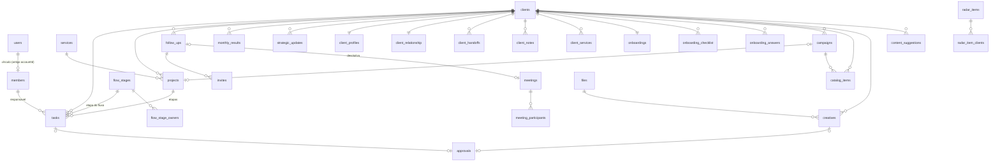

# Modelo de dados · atual e proposto

- **Hoje:** banco de **documentos** da plataforma Claude, no estilo Firestore: coleção → documento JSON identificado por um id.
- **Proposta:** **PostgreSQL** relacional. O esquema completo está em `proposta/schema.sql`, testado em PostgreSQL 16 (43 tabelas e 1 visão, sem erros). Os dados iniciais estão em `proposta/seed_catalogos.sql` (17 famílias de segmento, 85 datas, 8 etapas de fluxo, 5 serviços, 14 objetivos, 12 itens de checklist e 9 perguntas de diagnóstico).
- **Tipos:** os tipos TypeScript equivalentes estão em `proposta/dominio/tipos.ts`.

Legenda: **[V]** verificado no código, **[I]** inferido, **[C]** a confirmar.

---

## 1. Modelo atual (documentos)

### 1.1 Como o protótipo grava

- **API:** `db.collection(nome).doc(id).set(corpo)`. A gravação **substitui o documento inteiro**: não há atualização parcial nem controle de versão no cliente. Se duas pessoas editam o mesmo registro ao mesmo tempo, **vale a última gravação** [V].
- **Leitura:** todas as coleções de `COLS` são assinadas em tempo real (`onSnapshot`) e carregadas **inteiras** na memória do navegador ao abrir o CRM [V]. O chat carrega só os últimos 14 dias (filtro `date >= …`, até 180).
- **Campos automáticos** em toda gravação: `updatedAt` (ISO), `updatedBy` (id da conta) e `createdBy` (na primeira gravação).
- **Ids:** gerados no navegador por `Date.now().toString(36) + 5 caracteres aleatórios`. Alguns ids são compostos (ver tabela abaixo).
- **Datas:** texto `AAAA-MM-DD`, ou `AAAA-MM-DDTHH:MM` nas reuniões (datetime-local, **sem fuso**). Os instantes são ISO UTC.
- **Modo local:** sem banco, todas as coleções vão juntas para `localStorage['crm-mkt-local-v2']`, e as atualizações para `localStorage['crm-updates-local']`.

### 1.2 Coleções

| Coleção | Id do documento | Campos principais [V] | Volume no banco em 21/10/2026 [V] |
|---|---|---|---|
| `members` | uid ou `m-<nome>` | name, area, role, email, phone, admin, hideRank, capacity, color, accountId, photoId, skills, bio, bookingUrl, meetUrl, createdAt | 10 |
| `clients` | uid | name, legalName, cnpj, segment, address, contact, phone, email, otherContacts, stage, stageAt, value, source, ownerId (comercial), relId, strategistId, primaryObjective, objectives[], objHistory[], nextStep, nextStepDate, folderUrl, uploadUrl, lastReceived, lastTouch, logoId, satisfaction, contractStart, contractEnd, reajusteDate, packageNotes, closedAt, lostAt, churnedAt, lostReason, lostNote, notes[], rel{}, profile{}, handoff{}, onboarding{}, invites[], createdAt | **0** |
| `projects` | uid | title, clientId, ownerId, serviceId, priority, due, status, doneAt, helpdesk, desc, campaignId, milestones[] (**legado**), createdAt | 0 |
| `todos` (tarefas) | uid | title, requester, clientId, projectId, stageId, seq, assigneeId, tipo, categoria, subcategoria, nivel, qtd, formato, urgent, due, dueTime, desc, status, openedAt, startedAt, execAt, waitingSince, waitingWhat, doneAt, approval{}, history[], comments[], createdAt | 0 |
| `follows` | uid, ou `cad-<cliente>-<k>-d<n>` na cadência | clientId, type, step, dueFrom, dueTo, ownerId, ownerId2, goal, status, auto, source{kind,id,label}, doneAt, doneBy, doneMember, channel, result, satisfaction, notes, business, life, opportunity, move, back, meetingId, meetingAt, invites[], invitedAt, createdAt | 0 |
| `meetings` | uid | title, kind, scope, clientId, when (local, sem fuso), priority, place, memberIds[], notes, followId | **9** (todas externas; apontam para clientes que **não existem mais** no banco) |
| `catalog` | `<clientId>__<AAAA-MM>` | clientId, month, items[{id,date,format,theme,channel,objective,assigneeId,status,copy,campaignId}] | 0 |
| `campaigns` | uid | clientId, dateKey, date, dateName, name, objective, status, ownerId, prepStart, channels[], formats[], offer, briefing, projectId, catalogItemId, createdAt | 0 |
| `dates` (datas personalizadas) | uid | name, date, clientId, tip | 0 |
| `suggestions` (IA) | `<clientId>__<dateKey>` | clientId, dateKey, estrategia, oferta, ideas[], cronograma[], at | 0 |
| `creatives` | uid | title, link ou assetId, contentType, sizeBytes, fileName, clientId, format, status, statusAt, memberId, campaign, month, notes, approval{}, ts, createdAt | 0 |
| `results` | `<clientId>__<AAAA-MM>` | clientId, month, leads, conversas, alcance, seguidores, investimento, vendas, faturamento, notas | 0 |
| `objectives` | `o0`…`o13` ou uid | name, order | 14 |
| `services` | `s1`…`s5` ou uid | name, tagline, what, why, forWho, deliverables, metrics, timeToResult, questions, etapas (texto, um item por linha), order | 5 |
| `process` | `flow` | stages[{id,name,area,sla,desc,done,ownerIds[]}] (sem documento = usa o fluxo padrão do código) | 0 (usa o padrão) |
| `radar` | `r-AAAAMMDD-NN` (automação) ou `r-<uid>` (manual) | date, eventDate, eventTime, kind, title, summary, why, idea, segments[], tags[], clientIds[], source{title,url}, createdAt, createdBy, manual | 19 |
| `chat` | `<canal>__<AAAA-MM-DD>__<memberId>` (1 documento por pessoa por dia) | ch, date, author, msgs[{id,text,at,sys,link{act,id,v}}] | 1 |
| `updates/<accountId>/items` | uid | clientId, kind, text, at, by (conta), byMember, editedAt, editedBy | 1 (também aponta para cliente inexistente) |

Todas as coleções foram listadas em 21/10/2026. **Atenção:** as 9 reuniões e a 1 atualização estratégica citam **8 clientes diferentes que não estão mais na coleção `clients`**. Ou seja, os clientes existiram e foram excluídos (pela tela "Excluir cliente" ou por outro meio). É um exemplo concreto do problema de integridade do item 1.4.1 [V]. A causa precisa ser confirmada com a agência [C].

### 1.3 Estruturas aninhadas dentro de `clients` [V]

- `notes[]`: `{id, text, at (data), by (conta)}`.
- `objHistory[]`: `{at, primary, objectives[]}`, as últimas 20.
- `rel{}`: contactBirthday, family, interests, prefs, business, businessAt, life, lifeAt.
- `profile{}`: style, tone, channel, bestTime, values, audience, care, updatedAt, by.
- `handoff{}`: decisor, canal, expectations, promises, personal, at, by, sellerId.
- `onboarding{}`: startedAt, services[], checklist{c1..c12: {done, at}}, answers{q1..q9}.
- `invites[]`: `{at, channel, by}`, os últimos 10.

### 1.4 Problemas do modelo atual

1. **Sem integridade referencial:** excluir um cliente deixa tarefas, follow-ups, campanhas e resultados apontando para um id que não existe [V]. A tela mostra "Cliente removido".
2. **Documentos que crescem** (cliente com notas, histórico e convites; catálogo com todos os itens do mês; chat com todas as mensagens do dia): risco de conflito de edição e de limite de tamanho.
3. **Leitura total:** o navegador baixa todas as coleções a cada abertura. Não escala para centenas de clientes ou milhares de tarefas [I].
4. **Datas sem fuso:** "hoje" depende do relógio do computador de quem usa.
5. **Listas como texto** (serviços: um item por linha) e enumerações espalhadas pelo código.
6. **Campos legados:** `projects.milestones` (marcos antigos, substituídos por tarefas com `projectId`), `todos.priority` (removido pelo formulário novo) e área "Relacionamento com cliente" (renomeada para "Relacionamento" na leitura).

---

## 2. Modelo proposto (PostgreSQL)

### 2.1 Diagrama resumido

### 2.2 Mapeamento campo a campo (atual → proposto)

| Atual | Proposto | Observação |
|---|---|---|
| `members.accountId` | `members.user_id` → `users.id` | O login passa a ser próprio (ver ARQUITETURA §5) |
| `members.hideRank` | `members.show_in_ranking` (invertido) | — |
| `members.photoId` | `members.photo_file_id` → `files` | — |
| `members.skills` (texto com vírgulas) | `members.skills TEXT[]` | separar por vírgula |
| `clients.ownerId` | `clients.commercial_owner_id` | nome explícito |
| `clients.relId` | `clients.relationship_owner_id` | — |
| `clients.value` | `clients.monthly_value NUMERIC(12,2)` | — |
| `clients.primaryObjective`, `objectives[]` | `primary_objective_id` + `client_objectives` | — |
| `clients.objHistory[]` | `client_objective_history` | — |
| `clients.notes[]` | `client_notes` | — |
| `clients.rel{}` | `client_relationship` (1:1) | `prefs` → `service_prefs` |
| `clients.profile{}` | `client_profiles` (1:1) | + `audience_keywords[]` derivado |
| `clients.handoff{}` | `client_handoffs` (1:N, histórico) | hoje guarda só o último |
| `clients.onboarding.services[]` | `client_services` | são os serviços **contratados** |
| `clients.onboarding.checklist`, `answers`, `startedAt` | `onboarding_checklist`, `onboarding_answers`, `onboardings` | códigos c1..c12 e q1..q9 mantidos |
| `clients.invites[]` e `follows.invites[]` | `invites` | — |
| `clients.cnpj` (formatado) | `clients.cnpj CHAR(14)` só dígitos | formatar na tela; validar dígitos verificadores (proposta) |
| `clients.lastReceived` | `clients.last_material_at` | — |
| `todos` | `tasks` | — |
| `todos.tipo`, `categoria`, `subcategoria`, `nivel`, `qtd`, `formato` | `service_type`, `category`, `subcategory`, `effort_level`, `quantity`, `work_format` | — |
| `todos.due`, `dueTime` | `due_date DATE`, `due_time TIME` | — |
| `todos.execAt` | `exec_started_at` | índice único garante 1 por pessoa |
| `todos.history[]` | `task_status_history` | sem limite de 30 |
| `todos.comments[]` | `task_comments` | — |
| `todos.approval{}`, `creatives.approval{}` | `approvals` + `approval_id` | — |
| `todos.stageId` ('s-brief'…) | `tasks.flow_stage_id` → `flow_stages.code` | as regras dependem do código `s-aprov` |
| `process/flow.stages[]` | `flow_stages` + `flow_stage_owners` | — |
| `projects.milestones[]` | **não migrar** (legado) | converter em tarefas se houver dado [C] |
| `follows` | `follow_ups` | `step` → `cadence_step`; `back` → `return_on`; `move` → `moved_to_stage` |
| `follows.source{}` | `source_kind`, `source_id`, `source_label` | índice único evita duplicar |
| `meetings.when` (local) | `meetings.starts_at TIMESTAMPTZ` | converter assumindo America/Sao_Paulo |
| `meetings.memberIds[]` | `meeting_participants` | — |
| `catalog/<c>__<mês>.items[]` | `catalog_items` (1 linha por item) | o mês passa a ser derivado de `publish_date` |
| `campaigns.catalogItemId` | `catalog_items.campaign_id` (ligação invertida) | — |
| `suggestions` | `content_suggestions` | + `model`, `generated_by` |
| `results` | `monthly_results` | `month` = 1º dia do mês |
| `updates/<conta>/items` | `strategic_updates` | autor = `author_user_id` |
| `radar` | `radar_items` + `radar_item_clients` | `date` → `found_on`; "arquivar" passa a ser `archived_at` |
| `chat` (1 doc por pessoa por dia com `msgs[]`) | `chat_messages` (1 linha por mensagem) | `sys` → `is_system`; `link` → `link_action`/`link_target_id` |
| leitura do chat em `localStorage` | `chat_reads` | sincroniza entre aparelhos |
| constantes do código (FAMS, DT_LIST, CHECK, DIAG, serviços e fluxo padrão) | `segment_families`, `commemorative_dates`, `checklist_items`, `diagnostic_questions`, `services`, `flow_stages` | carga em `seed_catalogos.sql` |
| `createdBy`/`updatedBy`/`updatedAt` | colunas iguais + `audit_log` | — |
| (não existe) | `users`, `files`, `audit_log`, `deleted_at` | autenticação, arquivos, auditoria e exclusão lógica |

### 2.3 Regras garantidas pelo banco (novas)

- Uma tarefa "Em execução" por pessoa: índice único parcial `tasks_one_exec_per_member`. Testado: a segunda inserção é recusada.
- Tarefa "Aguardando cliente" exige `waiting_since`; tarefa "Concluída" exige `done_on`.
- Reunião externa exige cliente; reunião interna não tem cliente.
- Follow-up: `due_to >= due_from`; segunda pessoa diferente da primeira; follow automático não se repete por origem.
- Criativo tem **ou** arquivo **ou** link.
- Links começam com http(s); CNPJ com 14 dígitos; satisfação de 1 a 5; mês de resultado no dia 1; valores ≥ 0.
- Fim do contrato ≥ início.

### 2.4 Cálculos que **não** devem ficar gravados (derivados)

Saúde da conta, carga semanal (ver a visão `v_member_week_load`), estado de prazo (atrasada ou perto do prazo), conversão, ranking, lista "aguardando o cliente", renovações e resultados pendentes. Devem ser calculados no back-end a cada consulta, com as funções de `proposta/dominio/regras.ts`. Se o volume crescer, viram visões materializadas.

`clients.segment_family` e `client_profiles.audience_keywords` **são** gravados, mas sempre recalculados pelo back-end ao salvar, para servir de índice ao radar.

### 2.5 Se a empresa preferir MySQL 8

O esquema foi escrito para ser portável. Ajustes necessários:

| PostgreSQL | MySQL 8 |
|---|---|
| `UUID` + `gen_random_uuid()` | `BINARY(16)` com `UUID_TO_BIN(UUID(),1)` ou `CHAR(36)` |
| `TEXT[]` (skills, segments, tags, channels, formats, listas dos serviços, objective_ids) | `JSON` com `JSON_ARRAY`, ou tabelas de ligação; para `segments` do radar usar índice multivalorado `CAST(segments AS CHAR(32) ARRAY)` |
| `CITEXT` | `VARCHAR(320)` com collation `utf8mb4_0900_ai_ci` (já não diferencia maiúsculas) |
| `TIMESTAMPTZ` | `DATETIME(3)` sempre em UTC (conversão na aplicação) |
| `JSONB` | `JSON` |
| índices parciais (`WHERE …`) | não existem: usar coluna gerada (ex.: `exec_member_id = IF(status='Em execução', assignee_id, NULL)`) com índice único |
| `CHECK` com regex `~*` | `REGEXP_LIKE()` (MySQL 8.0.16+ aplica CHECK) |
| `pg_trgm` (busca) | índice `FULLTEXT` com parser `ngram` |
| `BIGSERIAL` | `BIGINT AUTO_INCREMENT` |
| visão com `date_trunc` | `DATE_SUB(d, INTERVAL WEEKDAY(d) DAY)` |

**Recomendação: PostgreSQL.** Arrays, índices parciais, JSONB e busca por trecho cobrem as regras do sistema com menos código. A justificativa completa está em ARQUITETURA_TECNICA §4.

---

## 3. Migração dos dados atuais

1. **Exportar** cada coleção do banco do artifact (ver INVENTARIO_ARQUIVOS §4). Os documentos saem como JSON, um arquivo por documento.
2. **Carregar os catálogos:** `seed_catalogos.sql` é idempotente se rodado em banco limpo. Serviços e objetivos podem vir do export, se a agência os editou; hoje são os padrões.
3. **Converter**, com um script em TypeScript, seguindo a tabela 2.2:
   - Gerar `users` a partir dos e-mails dos integrantes (convite para criar senha ou SSO).
   - Montar o mapa `legacy_id → uuid` para resolver as referências (`clientId`, `assigneeId`, `ownerId`…).
   - Converter datas sem fuso (`meetings.when`) assumindo America/Sao_Paulo.
   - Separar arrays aninhados nas tabelas filhas.
   - Copiar os arquivos (`/_blob/<id>`) para o novo armazenamento. Só funciona estando logado no Claude; ver INVENTARIO §4.
4. **Conferir contagens** por tabela e por cliente (tarefas abertas, follow-ups pendentes, saúde da conta) entre o protótipo e o novo sistema.
5. **Situação hoje [V]:** o banco tem equipe, serviços, objetivos, radar, 1 conversa, 9 reuniões e 1 atualização estratégica; os clientes a que essas reuniões se referem foram excluídos. Se a agência continuar usando o protótipo até a troca, repetir a exportação no dia da virada.
